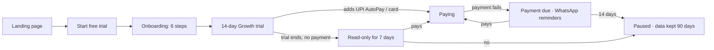
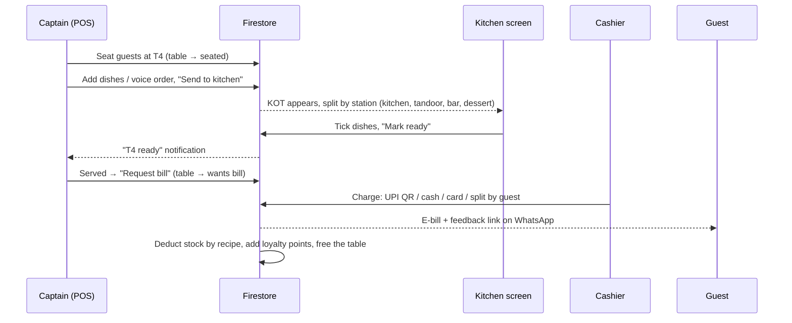

# Restro — workflow and build plan

Restro is a multi-restaurant SaaS: one app, many restaurants, each paying a
monthly plan. This document covers who uses it, how the main flows work, how
the screens map to those flows, and how the Firebase backend will plug in.

> Status: **UI + workflow prototype.** Every screen works with sample data
> from `lib/mock.ts`. Nothing is saved yet. The next phase replaces
> `lib/repo.ts` with Firebase.

---

## 1. Who uses Restro

| Person | Where | What they do |
|---|---|---|
| **You (platform owner)** | `/admin` | See every restaurant, plan, trial and payment. Set prices. Extend trials, send payment reminders, pause accounts. |
| **Restaurant owner** | `/app` (phone or laptop) | Reads the Pulse briefing, checks reports, approves refunds, manages menu, staff, plan. |
| **Manager** | `/app` | Runs the floor, closes the day, handles stock and rota. |
| **Captain / waiter** | `/app/pos`, `/app/tables` (phone or tablet) | Seats guests, takes orders (tap or voice), sends KOTs, requests the bill. |
| **Cashier** | `/app/pos`, `/app/orders` | Charges bills — UPI QR, cash, card, split. |
| **Chef** | `/app/kitchen` (tablet on the wall) | Sees tickets by station, ticks dishes done, marks orders ready. |
| **Guest** | `/order/{table}` (their own phone, from the table QR) | Orders, calls the waiter, pays their share, rates the meal. |

Roles are permission sets, not hard-coded checks (Settings → Who can do what).

---

## 2. Screen map

```
/                 Landing page + pricing (marketing)
/pricing          Plan comparison (also linked from Settings)
/login            Owner: mobile + OTP · Staff: tap your face, 4-digit PIN
/onboarding       6-step setup: place → bills → menu (snap photo) → tables → team → ready

/app              Pulse — AI briefing, today's numbers, live floor/kitchen/online
/app/pos          New order — dishes, voice order, cart, send KOT, charge
/app/orders       All orders — open / online / ready / paid, accept online orders
/app/tables       Floor plan, waitlist with predicted wait, tonight's bookings, table QR
/app/kitchen      Kitchen display — New / Cooking / Ready, stations, "to cook" counts
/app/menu         Dishes, availability, recipes · "What's working" (menu engineering)
/app/inventory    Stock levels · Tomorrow's prep forecast · Purchase orders + receiving
/app/team         Who's in, clock in/out · Rota · Pay (salary, advances, tip pool)
/app/guests       Guest book, segments, win-back · Reviews (review booster)
/app/campaigns    WhatsApp/SMS campaigns · Automatic messages · Coupons, happy hours
/app/insights     Ask Restro (questions in plain words) · Leak guard · Money saved
/app/reports      Sales, P&L, day close, GST (GSTR-1/3B), expenses, downloads
/app/settings     Plan + billing, restaurant, outlets, roles, GST, payments, ordering, printers, security

/order/{table}    Guest QR ordering + split pay + feedback
/admin            Platform owner console
```

Phones get a bottom tab bar (Pulse · Orders · New order · Tables · More) and
bottom sheets. Laptops and tablets get a sidebar and side panels.

---

## 3. Main flows

### 3.1 A restaurant signs up (your sales funnel)



### 3.2 Dine-in order (captain)



### 3.3 Guest QR order and split pay

1. Guest scans the table QR → `/order/T3` (no app, no login).
2. Picks dishes → "Place order". If *Orders need captain approval* is on, the
   order waits in **Orders → Online**; otherwise it goes straight to the kitchen.
3. Guest sees live status (Received → Cooking → At your table), can **Call waiter**.
4. **Pay my share**: split equally, or tick what I ate → UPI intent (GPay/PhonePe/Paytm).
5. After paying: 1–5 stars. 4–5 → Google review link. 1–3 → private note to the owner.

### 3.4 Online orders (WhatsApp, Swiggy, Zomato)

Arrive in **Orders → Online** as *New*. Staff tap **Accept** → KOT goes to the
kitchen, same as any other order. Aggregator commission is tracked so the owner
sees what Swiggy/Zomato really cost (Insights).

### 3.5 Stock

```
Dish sold ──(recipe)──▶ ingredients deducted
Nightly job ──▶ forecast tomorrow's guests ──▶ prep list for the chef
                                            └─▶ suggested purchase orders per supplier ──▶ WhatsApp to supplier
Delivery arrives ──▶ "Receive" (actual qty, expiry, bill photo) ──▶ stock + supplier balance updated
Waste logged ──▶ stock reduced, reason saved
Actual usage vs recipe > 10% ──▶ Leak guard alert
```

### 3.6 End of day

Day close (Reports): count cash → Restro shows short/over → owner gets the
summary on WhatsApp → overnight jobs build tomorrow's **Pulse** briefing,
forecast and Leak guard alerts.

---

## 4. What makes Restro different (USPs)

| Feature | Screen | What it needs in production |
|---|---|---|
| **Restro Pulse** — daily briefing in plain words + 3 actions | `/app` | Nightly Cloud Function that summarises the day's data and calls an LLM to write the note |
| **Voice ordering** (मराठी / हिंदी / English) | POS → Speak | Speech-to-text with Indian languages (e.g. Google Speech-to-Text, Sarvam AI) + dish-name matching |
| **Split by guest** UPI payments | Checkout, `/order/{table}` | UPI intent links per share; payment confirmation via a payment provider (Razorpay/Cashfree) or manual confirm |
| **Prep forecast** + auto purchase orders | Stock → Tomorrow's prep | Nightly forecast from 8 weeks of sales, weekday, festival calendar, weather API |
| **Menu engineering** (Stars / Workhorses / Hidden gems / Rethink) | Menu → What's working | Plain calculation from sales + recipe cost |
| **Leak guard** | Insights | Scheduled rules over voids, discounts, cash close, stock usage |
| **Ask Restro** | Insights | LLM with read-only tools over the restaurant's own aggregates |
| **Review booster** | Guests → Reviews, guest page | WhatsApp e-bill + rating link; Google review URL per outlet |
| **Smart waitlist** with predicted wait + WhatsApp | Tables | Table turn-time average per table size |
| **WhatsApp everywhere** | many | WhatsApp Business API provider (Meta Cloud API, Gupshup, Interakt…) |
| **Snap-your-menu onboarding** | Onboarding step 3 | Vision model reads a menu photo into dishes + prices |
| **Marathi / Hindi UI** | sidebar / More | `lib/i18n.tsx` dictionary (extend to all strings) |

---

## 5. Firebase plan (next phase)

### 5.1 Services

| Need | Firebase service |
|---|---|
| Owner login (mobile OTP) | Firebase Auth — Phone |
| Staff PIN login | Cloud Function checks PIN → returns a **custom token** with claims `{ rid, oid, role }` |
| Data | Cloud Firestore (with offline persistence on so billing keeps working without internet) |
| Dish photos, bill photos, documents | Cloud Storage |
| KOT routing, stock deduction, loyalty, nightly jobs | Cloud Functions (Firestore triggers + scheduled) |
| Hosting the Next.js app | Firebase App Hosting (or Vercel) |
| Push to captains' phones | Firebase Cloud Messaging |
| Your SaaS subscriptions | Razorpay Subscriptions / UPI AutoPay → webhook → Cloud Function updates `restaurants/{rid}.billing` |

### 5.2 Firestore structure (multi-tenant)

```
plans/{planId}                         name, monthly, yearly, features[], limits{}
restaurants/{rid}                      name, ownerUid, plan, status(trial|active|past-due|paused), trialEndsAt, billing{}
  members/{uid}                        name, phone, role, outletIds[], pinHash, active
  outlets/{oid}                        name, address, gstin, gstRate, upi, settings{}
    categories/{cid}
    menuItems/{mid}                    name, categoryId, price, diet, station, available, recipe[{ingredientId, qty}], photoPath
    tables/{tid}                       name, zone, seats, status, currentOrderId, qrToken
    orders/{orderId}                   number, type, channel, tableId, lines[], status, totals{}, payments[], createdBy, createdAt
    kots/{kotId}                       orderId, station, lines[], status   ← kitchen screen listens here
    ingredients/{iid}                  name, unit, stock, par, costPerUnit, supplierId
    stockMoves/{id}                    ingredientId, qty(+/-), reason(sale|purchase|waste|adjust), ref
    suppliers/{sid}  purchaseOrders/{poId}
    customers/{cuid}                   phone, name, visits, spend, points, tier, birthday, optIn
    feedback/{fid}   campaigns/{cid}   expenses/{eid}
    shifts/{id}  attendance/{id}  payroll/{month}
    dayCloses/{yyyy-mm-dd}             expected, counted, variance, by
    insights/{yyyy-mm-dd}              pulse{text, actions[]}, forecast{}, alerts[]
platform/stats                         (written by functions) MRR, counts — for /admin
```

Why sub-collections under each restaurant: one security rule (`request.auth.token.rid == rid`)
isolates every restaurant's data, and deleting a tenant is one recursive delete.

### 5.3 Security rules (sketch)

```js
match /restaurants/{rid}/{document=**} {
  allow read:  if request.auth.token.rid == rid;
  allow write: if request.auth.token.rid == rid && request.auth.token.role in ['owner','manager','captain','cashier','chef'];
}
// money is never trusted from the client: totals, tax and stock are
// recalculated in Cloud Functions on order write.
match /restaurants/{rid}/outlets/{oid}/orders/{id} {
  allow update: if request.auth.token.rid == rid
    && !request.resource.data.diff(resource.data).affectedKeys().hasAny(['totals','payments']);
}
// guests (QR page) write only to a public "guestOrders" inbox, validated by a function
```

### 5.4 Cloud Functions

| Trigger | Does |
|---|---|
| `orders` created/updated | Recalculate totals + GST server-side; create `kots` per station |
| order status → `paid` | Deduct stock by recipe, add loyalty points, free table, send WhatsApp e-bill |
| `guestOrders` created | Validate table token + prices, copy into `orders` |
| nightly 2 am | Pulse briefing, forecast, prep list, Leak guard alerts, platform stats |
| Razorpay webhook | Update plan/status; past-due reminders on WhatsApp |
| `staffLogin` (callable) | Check PIN hash → custom token |

### 5.5 Swapping the mock for Firebase

1. `npm i firebase` and add `lib/firebase.ts` (config from `.env.local`).
2. Re-implement each function in `lib/repo.ts` with Firestore reads
   (use `onSnapshot` for orders, tables and kitchen so screens update live).
3. Replace the `useState(repo.x())` lines in each page with a small hook, e.g.
   `useCollection("orders", where("status","in",[...]))`.
4. Replace the demo actions (`toast(...)`) with real writes.

---

## 6. Build order (suggested)

1. **Core money loop** — Auth, restaurants/outlets, menu, tables, POS, orders, KOT, kitchen, checkout (UPI QR/cash/card), receipts. *Enough to sell Starter.*
2. **SaaS billing** — plans, trials, Razorpay subscriptions, `/admin` live data.
3. **Guest QR + split pay + WhatsApp e-bill + review booster.** *Sells Growth.*
4. **Stock, recipes, purchase orders, team & payroll, reports + GST exports.**
5. **AI layer** — Pulse, forecast, Leak guard, Ask Restro, voice ordering, snap-your-menu. *Sells Pro.*
6. Swiggy/Zomato order integration (needs their partner approval), multi-outlet chain features.

## 7. Things to decide

- WhatsApp provider (Meta Cloud API direct vs Gupshup/Interakt) — per-message cost affects pricing.
- Payment confirmation for UPI: manual "Payment received" (free) vs payment provider with auto-confirm (fees).
- Thermal printing from the browser: print dialog (works today) vs a small print-bridge app for silent printing.
- Final plan prices (currently ₹999 / ₹2,499 / ₹4,999 per outlet per month — editable in `/admin`).
